<picture><source media="(prefers-color-scheme: dark)" srcset="assets/header-dark.svg"></picture>

  

### 👨‍💻 About me

- 🎓 MSc Computer Science student at **The University of Hong Kong**
- 🍃 Building **[Nomi](https://github.com/Jasonsu22/Nomi)**, a macOS app that transcribes and translates lectures on device
- 🔭 Into on-device ML, developer tools and games
- 🌏 I write and speak English and 中文
- 📫 Reach me at **jasonsu210@gmail.com**

### 🛠️ Tech stack

  

<picture><source media="(prefers-color-scheme: dark)" srcset="assets/footer-dark.svg"></picture>

